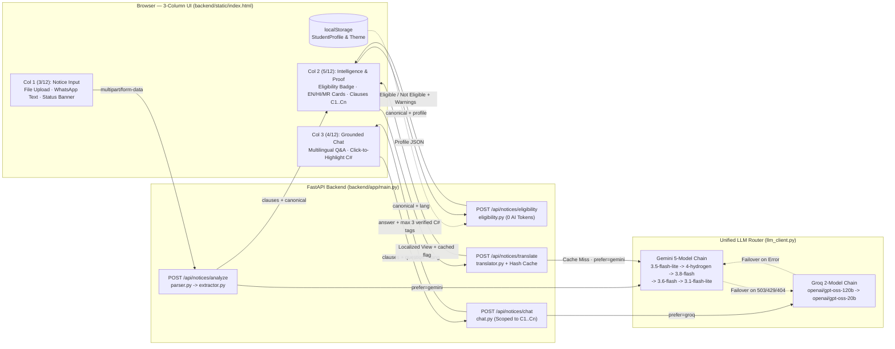
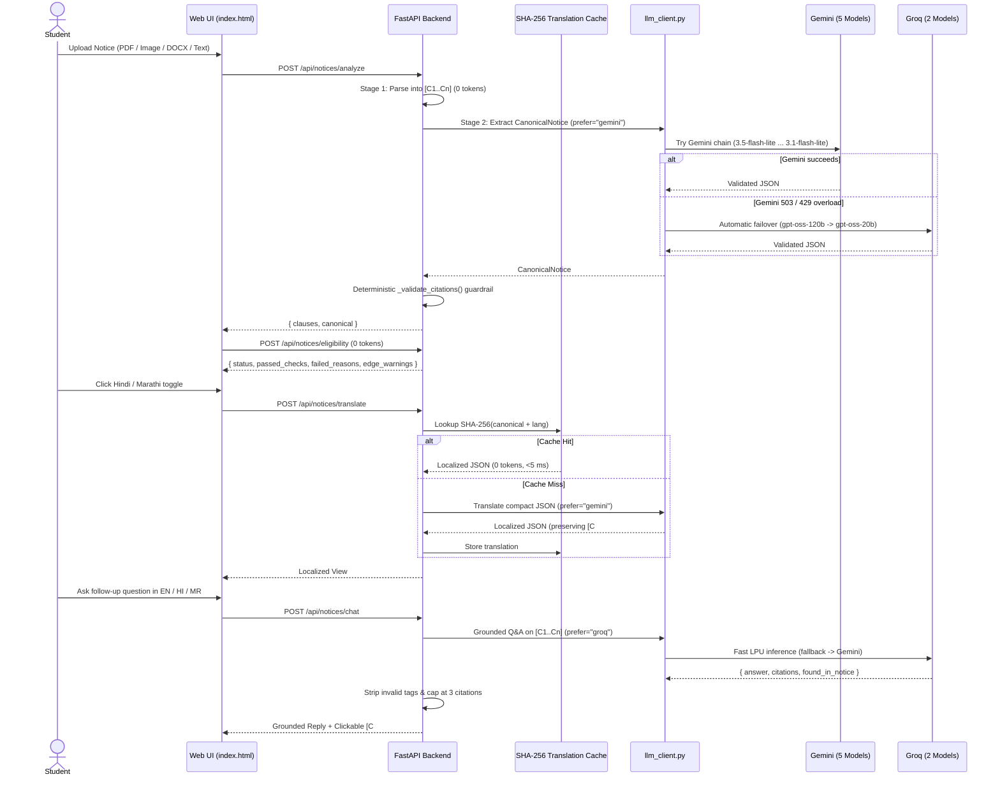

# System Architecture & Engineering Deep Dive

## 0. Architecture Diagrams

### A. End-to-End System & UI Architecture

### B. Multi-Provider Failover & Caching Sequence

## 1. System vs. AI Responsibility Split

NoticeMitra strictly separates **deterministic system code** (facts, coordinates, math, validation, caching) from **generative AI** (semantic extraction, natural regional phrasing, grounded reasoning):

| Stage                                          | System (Deterministic Code)                                                                                    | AI (LLM)                                                                                    | Key Benefit                                          |
| :--------------------------------------------- | :------------------------------------------------------------------------------------------------------------- | :------------------------------------------------------------------------------------------ | :--------------------------------------------------- |
| **1. Ingestion (`parser.py`)**         | PyMuPDF (digital PDF), RapidOCR ONNX (images/scans), `python-docx` (Word), raw text splitter → `[C1..Cn]` | None                                                                                        | 0 AI tokens; zero hallucination on raw numbers/dates |
| **2. Extraction (`extractor.py`)**     | Pydantic `CanonicalNotice` schema + `_validate_citations()` guardrail                                      | **AI Call #1 (Once):** Extracts summary, deadlines, docs, hard rules, edge conditions | Compact source of truth; fake `[C#]` tags blocked  |
| **3A. Eligibility (`eligibility.py`)** | Pure Python comparison against `StudentProfile`                                                              | None                                                                                        | Instant (<5 ms), 0 tokens, 100% accurate math        |
| **3B. Localization (`translator.py`)** | SHA-256 content-hash cache lookup                                                                              | **AI Call #2 (Cache miss only):** Natural EN → HI / MR JSON translation              | ~70% token reduction; 0 tokens on repeat views       |
| **4. Follow-Up Chat (`chat.py`)**      | Clause scoping (`[C1..Cn]`) + citation cap (max 3 verified tags)                                             | **AI Call #3:** Strict grounded Q&A in EN / HI / MR                                   | Refuses out-of-notice queries; fast LPU inference    |

---

## 2. Multi-Provider LLM Failover Router (`llm_client.py`)

Relying on a single hosted model exposes live applications to transient `503 UNAVAILABLE` congestion spikes and `429` rate limits. NoticeMitra centralizes all model calls inside `backend/app/llm_client.py` with **7 models across 2 providers**:

* **Gemini Chain (5 Models):** `gemini-3.5-flash-lite` → `gemini-4-hydrogen` → `gemini-3.8-flash` → `gemini-3.6-flash` → `gemini-3.1-flash-lite`
* **Groq Chain (2 Models):** `openai/gpt-oss-120b` → `openai/gpt-oss-20b`

### Task-Aware Routing Strategy

* **`prefer="gemini"` (`extractor.py`, `translator.py`):** Leverages Gemini's native Pydantic `response_schema` and strong Devanagari fluency for Hindi/Marathi; automatically fails over to Groq JSON mode if all Gemini models are congested.
* **`prefer="groq"` (`chat.py`):** Leverages Groq's low-latency inference for responsive student Q&A; automatically falls back to Gemini if Groq is unavailable.

---

## 3. Data Flow & Guardrails

1. **Citation Guardrail:** Both `extractor.py` and `chat.py` build a `valid_codes = {c["clause_code"] for c in clauses}` set from Stage 1 output. Any AI-returned citation not present in `valid_codes` is dropped before returning JSON to the client.
2. **Strict Refusal Contract (`ChatReply`):** Every chat response returns `{ answer, citations, found_in_notice }`. When `found_in_notice` is `false`, the UI displays an explicit warning indicator (`Not explicitly found in notice`) rather than presenting an assumption as fact.
3. **Zero-Auth Profile Portability:** Student profiles (`branch`, `year`, `category`, `cgpa`, `family_income`, `active_backlogs`) are stored in browser `localStorage` and sent on demand to `/api/notices/eligibility`, allowing instant persona switching during demos without login friction.

---

## 4. Frontend Architecture (`backend/static/index.html`)

Served directly by FastAPI at `GET /` (zero separate build pipeline, zero CORS issues):

* **3-Column Desktop Workspace (`3 : 5 : 4` ratio):**
  * **Left Column (3 cols — Sticky):** File upload (`.pdf`, `.png`, `.jpg`, `.jpeg`, `.docx`), WhatsApp text input, sample circular loader, and live 3-step progress/error status banner.
  * **Center Column (5 cols):** Personalized Eligibility Banner, conditional edge-rule warnings, localized Summary / Deadlines / Required Documents cards, and scrollable Indexed Source Clauses (`[C1..Cn]`) viewer.
  * **Right Column (4 cols — Sticky):** Full-height Grounded Multilingual Follow-Up Chat with compact clickable `[C#]` proof chips.
* **Theme & Localization:** Persistent Light/Dark theme toggle (`localStorage`) and 1-click `English | हिंदी | मराठी` switcher.
